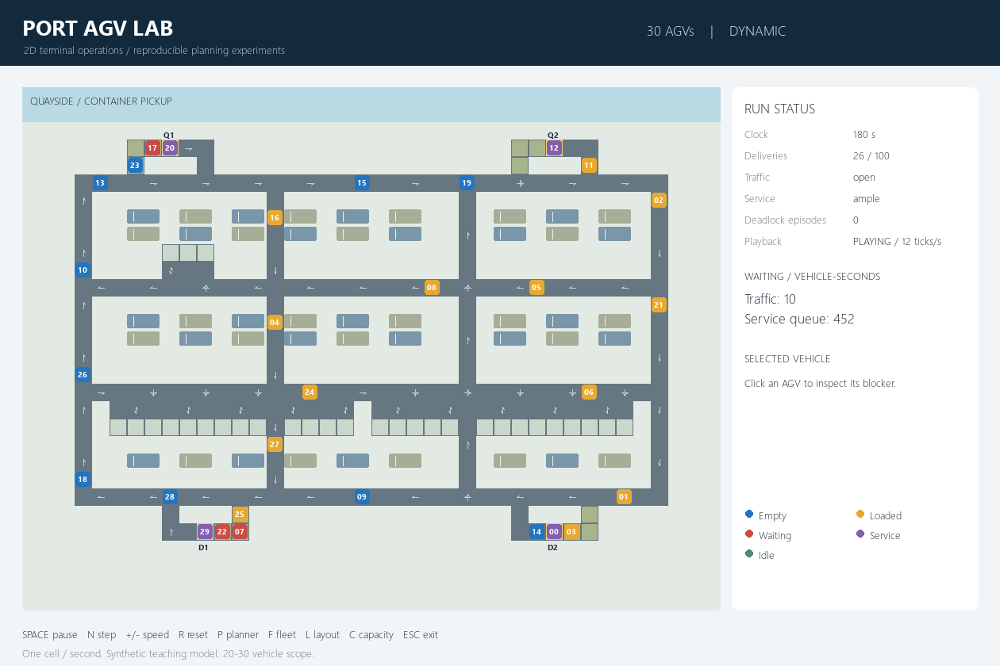

# Port AGV path-planning demo

A reproducible **2D container-port demonstration for 20, 25, and 30 AGVs**.
It compares shortest paths with dynamic priorities (the baseline), shortest
paths with fixed priorities, and rolling-horizon space-time reservations.
All three use the same PettingZoo Parallel environment, FIFO dispatcher,
service resources, collision rules, and seeded workloads.

This implements the **AGV Port Simulation Refocused Project Plan.docx** already
in this repository. The earlier 3D outline is retained as reference material;
3D, material physics, 500-vehicle stress testing, sensors, and RL are outside
this demonstration's scope. All geometry and service parameters are synthetic.



Recorded validation: **35 tests pass**, and all 18 open-layout, 100-task runs
completed without collisions or inventory failures. The separate bottleneck
batch exposes documented deadlocks/timeouts. See [validation details](docs/validation.md)
and the actual compact outputs in [examples/validation](examples/validation/).

## Install

Use **Python 3.12** (the dependency lock was resolved for Python 3.12 on Windows).
From the repository directory, open PowerShell:

```powershell
py -3.12 -m venv .venv
.\.venv\Scripts\python.exe -m pip install -r requirements-lock.txt
.\.venv\Scripts\python.exe -m pip install --no-build-isolation --no-deps -e .
```

On macOS/Linux, use `python3.12 -m venv .venv` and `.venv/bin/python` in the
same commands. Windows wheels in the lock are not vendored; pip resolves the
listed versions for the current platform. A graphical desktop is required
only for the interactive viewer. Headless runs do not import Pygame.

## Launch the demo

```powershell
.\.venv\Scripts\python.exe -m port_agv demo --config configs/demo.json
.\.venv\Scripts\python.exe -m port_agv demo --fleet 30 --planner reservations
```

| Control | Effect |
| --- | --- |
| Space | Pause/resume |
| N | Pause and advance one simulation tick |
| + / - | Change playback speed |
| Click AGV | Show its task, route, wait reason, and blocker |
| R | Reset to the same seed |
| P | Cycle planners and reset |
| F | Cycle 20/25/30 vehicles and reset |
| L | Switch open/bottleneck traffic layout and reset |
| C | Switch ample/constrained service and reset |
| Escape | Close |

One tick is one simulated second; playback speed does not change the model.
Vehicles are blue when empty, gold when loaded, purple during service, red
when waiting, and green while idle. The status panel separates traffic waits
from service-queue waits. The viewer reads state without advancing it.

## Save a run and replay it

```powershell
.\.venv\Scripts\python.exe -m port_agv run --fleet 20 --planner dynamic --seed 7 --out runs/demo-dynamic
.\.venv\Scripts\python.exe -m port_agv replay runs/demo-dynamic
```

Use a new output directory for each run. Existing evidence directories are
never silently overwritten. A bundle contains:

- `manifest.json`: settings, exact task manifest, initial positions, versions,
  timing contract, task checksum, and pad-to-pad free-flow distances.
- `actions.jsonl`: decisions, priorities, wait diagnostics, search counts,
  and measured planning times.
- `events.jsonl`: releases, assignments, loading/unloading, rejections,
  confirmed deadlocks, and correctness failures.
- `vehicles.csv`: one mutually exclusive activity and blocker explanation
  per AGV per tick (omit using `--no-vehicle-log` for compact batches).
- `tasks.csv`: every task, including unfinished work.
- `summary.json`: the five required metric groups and authoritative trace hash.

Replay executes recorded actions and verifies the final cumulative state hash.
This supports exact replay on a pinned build; it is not a general snapshot
restore or external-controller time-travel feature.

## Compare methods

Start with a short integration batch, then increase task counts and seeds:

```powershell
.\.venv\Scripts\python.exe -m port_agv compare --fleets 20 --layouts open --capacities ample --seeds 0 --tasks 10 --max-ticks 2000 --out runs/integration
.\.venv\Scripts\python.exe -m port_agv compare --seeds 0 1 2 3 4 5 6 7 8 9 --out runs/full-study
```

The full matrix is **3 fleet sizes x 2 layouts x 2 service settings x 3 planners
x 10 seeds = 360 runs**, with 100 jobs per run and a 10,000-tick limit.
Run duration depends on hardware and on the reservation search. No real-time
performance target is claimed. Timeouts and deadlocks remain in the output.
Every seed produces the same exogenous task sequence across all methods,
fleets, layouts, and capacities. Larger fleets retain the same seeded prefix
of starting bays.

`compare` creates `summary.csv`, `comparison.png`, `paired_differences.csv`,
and `report.md`, plus each run's evidence bundle. `--skip-report` defers charts.
To regenerate analysis, use:

```powershell
.\.venv\Scripts\python.exe -m port_agv report runs/integration/summary.csv
```

The plots cover completed deliveries, conditional task completion time,
waiting per vehicle, deadlocked-run fraction, planning p95, and timeout fraction.
Paired differences compare a candidate with the dynamic baseline on the same
seed and condition. Bootstrap intervals require at least two seeds and are
exploratory with small samples. Completion times must be read alongside the
number of unfinished tasks; no result is fabricated or preselected as best.

### Separate traffic from capacity

1. Hold layout fixed and compare 5-second versus 20-second service times.
2. Hold service fixed and compare open versus bottleneck traffic connections.
3. Inspect traffic waits, service-queue waits, active handling, idle time, and
   spillback blockers in the logs rather than attributing every slowdown to routing.

The open and bottleneck graphs can have different free-flow distances, which
are stored in each manifest. A raw layout difference is not an isolated causal
measure of coordination quality. A full service queue can also cause traffic
spillback; report those interactions explicitly.

## Model and algorithms

- A 40 x 30 synthetic directed lane network has two quay pickup pads, two yard
  drop-off pads, three physical queue cells per pad, and 30 private parking bays.
  The open layout has separate interior north/south connectors; the bottleneck
  replaces them with one shared two-way connector. Both retain a perimeter route.
- AGVs occupy one cell and move one adjacent edge or wait per tick. There is
  no acceleration, continuous footprint, or turning-radius model in this scope.
- Tasks release every two ticks by default. Oldest eligible tasks go to the
  lowest-ID idle AGV and remain assigned until delivered. One container has one
  custody record; it changes only on completed handover.
- Same-cell conflicts are resolved by planner priority. Opposing swaps are
  rejected. A blocked follower chain is rechecked before all moves commit
  simultaneously. Independent occupancy, edge, and custody assertions monitor
  the committed state.
- Dynamic priority ages consecutive **traffic** waits and resets after motion;
  fixed priority uses AGV ID. Both follow unit-cost shortest routes.
- Reservations use bounded cell/time search, legal waits, vertex and opposite-edge
  checks, a 10-tick lookahead, and a one-tick commit. Other AGVs start with safe
  full-horizon holds; each is replaced only by a feasible route. This conservative
  scheme can miss coordinated escapes and is **not deadlock-free**. Infeasible
  searches retain safe holds; they never dispatch a partially repaired plan.
- A suspected deadlock needs at least 20 no-progress ticks in a blocked group.
  A wait cycle is confirmed only if no member has a free immediate escape and
  no active service release breaks the chain. This conservative diagnostic can
  undercount more complex deadlocks. Other stalls remain visible as timeouts.
- PettingZoo rewards are zero because this study compares explicit planning
  metrics, not reward-optimizing learning policies. All live agents receive
  simultaneous actions; parked AGVs remain present until the episode ends.

Planning runs with virtual time paused. Measured planner time excludes rendering
and file writing and is absent from deterministic state hashes. A wall-clock
deadline/control experiment would require a separately modeled delay contract.

## Verification commands

```powershell
.\.venv\Scripts\python.exe -m pytest -q
.\.venv\Scripts\python.exe -m port_agv snapshot --fleet 30 --planner dynamic --ticks 180 --out runs/preview.png
```

The supplied suite covers shared destinations, head-on swaps and follower
chains, closures, parked agents, stale plans, termination versus truncation,
container conservation, same-seed replay, replay tampering, reservation prefix
safety, and `parallel_api_test` / `parallel_seed_test`. It also checks 20/25/30
vehicle starts and headless rendering. Commands above describe verification;
they do not imply an experiment has already been run.

## Project layout

```text
src/port_agv/
  model.py       configuration and shared records
  layout.py      lane graph, queues, parking, and shortest routes
  env.py         authoritative time, tasks, resources, motion, and monitors
  planners.py    dynamic, fixed, and rolling-horizon planners
  runner.py      run evidence, paired batches, and exact action replay
  viewer.py      interactive 2D inspection and RGB rendering
  report.py      charts and paired-seed analysis
  cli.py         demo/run/compare/report/replay/snapshot commands
configs/         editable demo configuration
tests/           correctness, API, replay, and statistics checks
docs/            implementation decisions and requirement traceability
```

## References

- The repository's **AGV Port Simulation Refocused Project Plan.docx**, especially
  environment implementation, planner integration, and delivery checks.
- Industrial simulator plan, sections 6-10 and 16-20: task custody, timing,
  safe coordination, reproducible evaluation, and evidence. This demo deliberately
  uses the revised coursework's simpler 2D fidelity rather than industrial motion.
- [PettingZoo Parallel API](https://pettingzoo.farama.org/api/parallel/)
- [PettingZoo environment tests](https://pettingzoo.farama.org/content/environment_tests/)
- [Pygame documentation](https://www.pygame.org/docs/)

The existing Word documents are preserved. No terminal layouts, paid assets,
research solver code, or private operational data are bundled.
